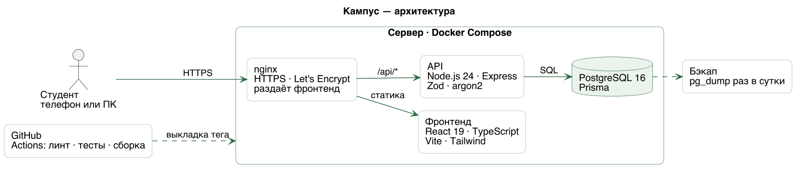
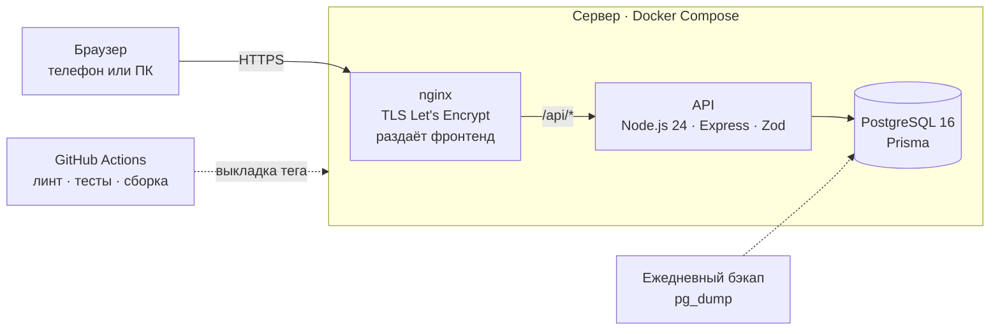

# Архитектура



Исходник картинки — [architecture.puml](architecture.puml) (PlantUML).



Один домен: nginx отдаёт собранный фронтенд и проксирует `/api/*` в API. Фронтенд и API на одном
адресе, поэтому нет CORS, а сессия живёт в cookie `httpOnly`.

## Стек

| Слой | Технологии | Зачем именно это |
|---|---|---|
| Дизайн | Figma: макеты для телефона и ПК, UI-kit | Экраны утверждаются до кода |
| Фронтенд | React 19 · TypeScript · Vite · Tailwind CSS | Типы ловят ошибки контракта, Vite — быстрая сборка |
| Роутинг и данные | React Router · TanStack Query | Маршруты экранов; кеш запросов, загрузка и ошибки без своего кода |
| Моки | MSW по `openapi.yaml` | Фронтенд работает, пока бэкенд не готов |
| Бэкенд | Node.js 24 LTS · Express · Zod | Zod проверяет каждый запрос по той же схеме, что в контракте |
| Данные | PostgreSQL 16 · Prisma | Миграции в репозитории, типы моделей из схемы |
| Пароли и сессии | argon2 · сессия в таблице + cookie | Пароль не хранится, выход из аккаунта гасит сессию на сервере |
| Инфраструктура | Docker Compose · nginx · Let's Encrypt · GitHub Actions | Сервис поднимается одной командой, выкладка по тегу |
| Качество | Vitest · Playwright · oxlint | Расчёты — юнит-тестами, четыре сценария — в браузере |

## Структура фронтенда

```
frontend/src/
  app/          вход, роутер, провайдеры (запросы, текущий пользователь), защита маршрутов
  pages/        один файл на маршрут: собирает экран из модулей, своей логики нет
  features/
    auth/       вход, регистрация, профиль
    budget/     лимит на сегодня, операции, итоги месяца
    split/      группы, расходы, балансы, приглашение
    transfers/  проверка перевода и шторка предупреждения
    deals/      каталог скидок и фильтр
                в каждом модуле: api.ts (запросы), hooks.ts, компоненты модуля
  shared/
    api/        fetch-клиент, типы из openapi.yaml, разбор ошибок
    ui/         UI-kit: Button, Input, Card, Sheet (шторка), Money, EmptyState
    lib/        деньги (копейки ↔ «1 234,50 ₽»), даты
  mocks/        обработчики MSW по контракту
```

Правило зависимостей: `pages → features → shared`. Модуль не импортирует другой модуль; общее
выносится в `shared`.

| Маршрут | Экран | Доступ |
|---|---|---|
| `/login`, `/register` | Вход и регистрация | гость |
| `/` | Бюджет: сколько можно сегодня, прогресс месяца | вход |
| `/operations` | Операции и добавление траты | вход |
| `/split`, `/split/:groupId` | Группы, расходы и балансы | вход |
| `/invite/:token` | Вступление в группу по ссылке | вход (гостя — на вход и обратно) |
| `/transfer` | Перевод с проверкой | вход |
| `/deals` | Каталог скидок | все |
| `/profile` | Профиль, выход, удаление аккаунта | вход |

Адаптив: одна вёрстка от 390 до 1920 px. На телефоне навигация — нижняя панель, на ПК — боковая.

## Ключевые решения

| Решение | Почему |
|---|---|
| Деньги — целые копейки (`amount: 15050` = 150,50 ₽) | Нет ошибок округления float; деление до копейки считает сервер |
| Все расчёты (лимит, доли, балансы) — на сервере | Одна правда для всех экранов и для тестов |
| Чужой ресурс отвечает 404, а не 403 | Не раскрываем, что такой объект существует (критерий приёмки) |
| Переводы только моделируются | В MVP нет банковских API и реальных платежей |
| Сессия в cookie `httpOnly`, `Secure`, `SameSite=Lax` | Токен недоступен скриптам страницы |
| Лимит попыток входа — 5 в 15 минут на почту и IP (ответ 429) | Защита от подбора пароля |
| Ответ ошибкой всегда в одном формате `{ error: { code, message, fields? } }` | Фронтенд разбирает ошибки одним кодом |

## Расчёт «сегодня можно потратить»

```
осталось_на_утро = стипендия + доходы периода − траты периода до сегодняшнего дня
дней_осталось    = дата_следующей_стипендии − сегодня   (не меньше 1)
лимит_сегодня    = floor(осталось_на_утро / дней_осталось)
можно_ещё        = лимит_сегодня − траты_сегодня          (меньше нуля — перерасход)
```

Лимит пересчитывается после каждой операции. Перерасход сегодня уменьшает лимит следующих дней.

## Деление расхода в группе

Сумма делится поровну между выбранными участниками: каждому `floor(сумма / n)` копеек, остаток
(`сумма mod n` копеек) — по одной копейке первым участникам по порядку вступления. Сумма долей
всегда равна сумме расхода. Баланс участника = заплатил − его доли; положительный — ему должны.
